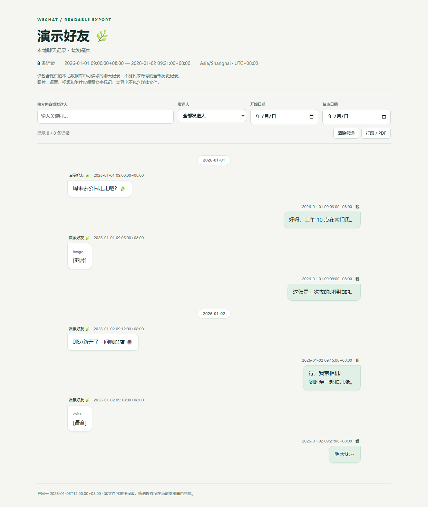

# 微信聊天记录 → 可阅读文件

把 **Windows 微信 4.x 本机保存的一个会话** 导出为可离线阅读、搜索和存档的文件。

- **HTML**：离线阅读、聊天文字搜索、筛选、打印。
- **TXT**：逐条保留北京时间、发送人和可解析文字。
- **JSON**：保留消息类型、来源分片、发送者映射状态和导出诊断。
- 支持私聊、群聊、指定日期范围，以及同一会话跨多个数据库分片的记录。
- 提供虚构数据演示和 JSON 重新转换功能，不打开微信也可以体验。

这是一个独立开源项目，与腾讯无隶属关系。v0.1.0 重点是**文字导出**：图片、语音、视频、表情和附件保留文字标记；不下载附件、不新增语音识别。



## 快速体验

需要 Python 3.10 或更高版本。以下为 Windows PowerShell 命令；无需激活虚拟环境。

```powershell
cd D:\Code\wechat-readable-export
py -3 -m venv .venv
.\.venv\Scripts\python.exe -m pip install -e .
.\.venv\Scripts\wechat-export.exe demo --output demo-output
Start-Process .\demo-output\chat.html
```

演示中的人名、ID 和内容均为虚构。macOS / Linux 也可以执行 `python -m wechat_readable_export demo`；读取真实微信数据库仅支持 Windows。

## 导出自己的聊天

### 1. 检查环境

打开并登录电脑版微信，保持微信运行：

```powershell
.\.venv\Scripts\wechat-export.exe doctor
.\.venv\Scripts\wechat-export.exe accounts
```

程序优先探测当前用户的 `Documents\xwechat_files`。如果微信数据保存在其他位置，请提供 `--data-dir`。可在微信设置中的存储位置查找；可以传 `xwechat_files` 根目录，也可以传包含 `db_storage` 的具体账号目录。

```powershell
.\.venv\Scripts\wechat-export.exe accounts --data-dir "E:\微信数据\xwechat_files"
```

发现多个账号时必须用 `--account` 指定目录名称，程序不会根据修改时间猜测账号。

### 2. 查询联系人或群聊

```powershell
.\.venv\Scripts\wechat-export.exe contacts --search "林同学"
```

输出为 `ID / 昵称 / 备注`。复制目标的唯一 ID；私聊通常以 `wxid_` 开头，群聊 ID 通常以 `@chatroom` 结尾。

```powershell
.\.venv\Scripts\wechat-export.exe contacts --data-dir "E:\微信数据\xwechat_files" --account "wxid_example_abcd" --search "读书群"
```

### 3. 导出指定会话

```powershell
.\.venv\Scripts\wechat-export.exe export --contact-id "wxid_example_friend" --output "exports\friend"
```

也可以直接按昵称或备注查询；存在多个匹配时会停止并列出候选 ID。

```powershell
.\.venv\Scripts\wechat-export.exe export --contact "林同学" --output "exports\friend"
```

只导出某个日期范围、只生成部分格式：

```powershell
.\.venv\Scripts\wechat-export.exe export --contact-id "wxid_example_friend" --start 2026-01-01 --end 2026-01-31 --format html txt --output "exports\january"
```

`--start` 和 `--end` 都按北京时间解释，**包含起止两天**。不传日期参数则读取该会话在本机可读取的全部记录。

### 输出内容

```text
exports/friend/
├── chat.html
├── chat.txt
└── chat.json
```

所有时间使用北京时间（UTC+08:00）。默认拒绝覆盖已有同名文件；选择新的 `--output`，或明确使用 `--overwrite`。

JSON 可以在不打开微信时重新生成阅读文件：

```powershell
.\.venv\Scripts\wechat-export.exe convert "exports\friend\chat.json" --format html txt --output "exports\recreated"
```

`convert` 只接受本项目 `schema_version=1` 的 JSON，不接受任意聊天软件的 JSON。

## 数据处理方式

程序只对 `Weixin.exe` 申请查询与只读内存访问，用于取得当前登录会话的数据库解密材料；密钥只留在本次进程内存中。它不注入 DLL、不写微信进程、不修改原数据库、不自动重启微信。

读取联系人时仅处理联系人数据库；导出时再处理消息数据库分片。解密副本位于系统临时目录，操作结束或正常异常退出时清理。SQLite 只读查询副本，发送者 ID 在各自分片的 `Name2Id` 中解析。校验失败会停止，不用猜测的密钥或发送者替代。未知消息类型和未映射身份会保留并产生提示。

导出路径不会发送聊天数据；生成的 HTML 不依赖 CDN、远程字体或网络服务。安装 Python 依赖需要联网。操作系统强制结束进程或断电可能使临时目录来不及清理，见 [排错说明](docs/TROUBLESHOOTING.md)。

`.gitignore` 排除了默认导出目录、`chat.*`、数据库和常见密钥文件。**它不能阻止你主动把改名后的真实聊天加入 Git**；发布前请检查 `git status` 和待提交内容。

## 支持范围与限制

- 读取 Windows 微信 **4.x** 的当前本地数据库；微信升级可能改变加密结构，需要重新验证。
- 已在 Windows 微信 **4.1.15.51** 完成一次真实本地读取核对，具体环境和验证边界见 [验证记录](docs/VALIDATION.md)。
- 手机独有、未同步到电脑、已删除或本机不存在的记录不在导出范围内。
- 不包含恢复已删除聊天、媒体原文件导出、在线账号登录、云端上传或微信消息发送。
- 原生语音转文字仅在本机记录中确实存在且格式可解析时保留。
- 原数据库或 WAL 正在变化、页认证失败或快照无法确认时会报错；稍后重试。WAL 预分配空间和可验证的旧世代数据帧不作为新消息应用。
- 数据库结构兼容性、验证状态与具体诊断见 `doctor` 输出、导出 JSON 的 `metadata` 和终端提示。

## 开发与测试

```powershell
.\.venv\Scripts\python.exe -m unittest discover -s tests -v
.\.venv\Scripts\python.exe -m pip wheel . --no-deps --wheel-dir dist
```

测试只使用合成数据，不需要微信和真实聊天。GitHub Actions 会在 Windows / Ubuntu 上执行测试；这不代表自动验证了所有微信版本。

```text
src/wechat_readable_export/
├── cli.py          # 参数、联系人唯一性、命令分发
├── backend.py      # Windows 只读读取与快照验证
├── parsing.py      # 消息解析、分片身份、排序、日期过滤
├── rendering.py    # 离线 HTML / TXT / JSON
├── models.py       # 共享数据模型
├── demo.py         # 虚构演示数据
└── _vendor/        # 固定来源的最小数据库读取代码
tests/
```

## 自己推送到 GitHub

在 GitHub 建立一个空仓库，然后执行：

```powershell
git init -b main
git add .
git status --short
git commit -m "Initial release: readable WeChat export"
git remote add origin https://github.com/YOUR_USERNAME/wechat-readable-export.git
git push -u origin main
```

不要将真实导出文件用作示例或问题附件。提交问题时可提供微信版本、Python 版本、异常类型和不含个人信息的诊断；无需提供数据库或密钥。

## 许可与致谢

本项目使用 [Apache License 2.0](LICENSE)。数据库读取与部分消息解析实现参考并改编自 `wechatauto-replica` 和 `wechat-chat-export`，固定提交、修改说明及许可见 [THIRD_PARTY_NOTICES.md](THIRD_PARTY_NOTICES.md)。
